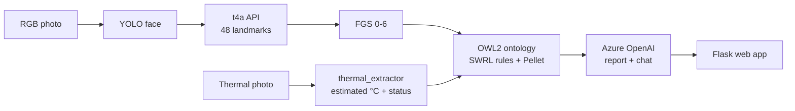

# AI-Tails · Multimodal feline pain analysis (MVP)

Prototype for MAKEathon 2026 (FHNW). From an **RGB photo of the cat's face** and a **thermal photo**:

1. **Vision**: YOLOv8 finds the face, the Tech4Animals API returns 48 landmarks, from which we compute the
   3 action units of the **Feline Grimace Scale** (ears, eyes, muzzle; total 0–6).
2. **Thermal**: from the thermal photo we estimate the body temperature and classify it
   (Hypothermia / Normothermia / Mild fever / High fever).
3. **Ontology** (OWL2 + SWRL rules, **Pellet** reasoner): combines face and temperature and infers the health
   status; it also returns **which rules fired** (XAI explanation).
4. **Azure OpenAI agent**: turns the results into a readable report and answers questions about it.

It is a demonstration screening tool, not a medical device.



## Quick start

Requirements: **Python 3.11+** and **Java 17+** on PATH (for Pellet).

```bash
python -m venv .venv
.venv\Scripts\activate            # macOS/Linux: source .venv/bin/activate
pip install -r requirements.txt
copy .env.example .env            # macOS/Linux: cp .env.example .env
```

1. Copy the **`cat_face_yolov8n.pt`** weights (provided by AI-Tails) into `models/`. They are not versioned in git.
2. Set **`LANDMARKS_API_URL`** in `.env` to the address of the Tech4Animals landmarks API.
3. (Optional) Set the **Azure OpenAI** variables (see below). Without them, an automatic summary is shown
   instead of the report, labelled as such.
4. Run `python app.py` and open **http://127.0.0.1:5000**.

The component status is shown at the top right of the app and on `GET /api/health`.

### Without the real landmarks API (development only)

If the Tech4Animals API is unreachable you can try the pipeline with a fake server that answers in the same
format with **synthetic** landmarks (known scores, not read from the photo):

```bash
python -m tools.mock_landmarks_server --profile pain     # healthy | moderate | pain
```

and in `.env`: `LANDMARKS_API_URL=http://127.0.0.1:6400/landmarks`. The app shows an orange warning on the
result whenever the landmarks come from the mock. The mock places each feature group (ears, cheeks, eye, muzzle)
at fixed positions inside the YOLO box, so the lines on the photo are only approximately on the face. On Windows some ports are reserved by the system: if you get
a socket access error, use `--port` with another port.

## Configuring Azure OpenAI

1. **Azure portal** → open the Azure OpenAI / **Azure AI Foundry** resource (for the hackathon:
   `y-afp-hsw-int-makeathon-01`, region *Sweden Central*).
2. **Azure AI Foundry** (`ai.azure.com`) → open the resource → **Deployments** → *Deploy model* → choose
   **GPT-6 Luna** and name the deployment **`gpt-6-luna`** (the name used in `.env.example`). The
   **deployment name** you enter there is what goes in `.env`.
   The key alone is not enough: without a deployment every call returns `DeploymentNotFound`.
3. In the resource, **Keys and Endpoint** page → *OpenAI* tab: copy the **Language APIs** endpoint and **KEY 1**.
4. Fill in `.env`:
   ```
   AZURE_OPENAI_ENDPOINT=https://<resource-name>.openai.azure.com/
   AZURE_OPENAI_API_KEY=<KEY 1>
   AZURE_OPENAI_DEPLOYMENT=<deployment name>
   AZURE_OPENAI_API_VERSION=2024-08-01-preview
   ```
5. Restart `python app.py`: the *Azure OpenAI* pill turns green. Never commit the `.env` file.

Note: gpt-6-luna only accepts the default `temperature`, so the agent does not send one. If Azure fails
(wrong deployment, quota, network), the report falls back to the automatic summary and shows the Azure error
under it; the chat shows the error directly.

## Expected inputs

| Input | Requirements |
|---|---|
| **RGB photo** | Close-up, frontal photo of the cat's face (JPG/PNG/WEBP). If YOLO finds no face, the analysis stops with a clear message. |
| **Thermal photo** | 640×480 false-colour image (or the same layout scaled) with the **scale bar on the right side** and max/min values printed at the top and bottom right, as in the **TICD** dataset and InfiRay/Hikmicro-style thermal cameras. Other layouts are not supported. |

Ready-made examples in `tests/fixtures/`: `cat_face.jpg` (RGB), `thermal_fever.jpg` and `thermal_cold.jpg` (TICD thermal).

## How it works

### Vision (`vision/`)
- `face.py`: AI-Tails YOLOv8n, face box with confidence ≥ `YOLO_MIN_CONF`.
- `detector.py`: client of the t4a API in the Tech4Animals notebook format
  (`{"name", "image": "data:image/jpeg;base64,..."}` → `[{"cat": {"landmarks": [...48]}}]`; if there are several
  animals, the one inside the YOLO box is picked) and FGS geometry in a single `ACTION_UNITS` table:

  | Action unit | Ratio | 0 (absent) | 1 (moderate) | 2 (marked) |
  |---|---|---|---|---|
  | Ears | tip distance / head width | < 1.2 | 1.2–1.5 | > 1.5 |
  | Eyes | eye height / width | > 0.6 | 0.4–0.6 | < 0.4 |
  | Muzzle | muzzle height / width | > 0.8 | 0.6–0.8 | < 0.6 |

  The landmark indices are in `DEFAULT_LANDMARK_MAP` and **must be verified** on real API responses.
- `thermal_extractor.py`: scale OCR → °C per pixel → cat segmentation → resampling to
  **32×24** (station sensor) → mean of the 3 hottest pixels → **+7.8 °C** surface→body offset
  measured on TICD (64 healthy indoor cats) → `classify_temperature()`:

  | Estimated temperature | Status | Severity |
  |---|---|---|
  | < 38.0 °C | Hypothermia | 1 |
  | 38.0–39.2 °C | Normothermia | 0 |
  | 39.2–40.0 °C | MildFever | 1 |
  | ≥ 40.0 °C | HighFever | 2 |

  It is a rule-based classifier, not a trained model (no labelled thermal data exists to train one);
  the function has the signature defined by the architecture, so an ML model can replace it.

### Ontology (`ontology/`)
- `feline_health_ontology.py`: classes `Cat`, `FacialFeature` (`EarPosition`, `OrbitalTightening`,
  `MuzzleTension`), `ActionUnitScore`, `HealthStatus`, `ThermalStatus`; properties `hasFeature`, `hasScore`,
  `hasHealthStatus`, `hasTotalScore`, `hasTemperature`, `hasThermalStatus`.
- `rules.py`: all SWRL rules in one table; each rule also has an equivalent Python predicate, used **only**
  if Pellet/Java is not available (the `reasoner` field of the response says which one was used).

  | Rule | Condition | Status |
  |---|---|---|
  | `fgs_good` | FGS ≤ 1 | Good |
  | `fgs_medium` | FGS 2–3 | Medium |
  | `fgs_poor` | FGS ≥ 4 | Poor |
  | `fgs_fever_acute` | FGS ≥ 4 **and** temperature ≥ 39.5 °C | AcuteInflammatoryPain |

  The status shown is the most severe one inferred; the fired rules come from the reasoner, not from `app.py`.
  Each analysis creates new individuals and removes them at the end, so analyses do not affect each other.

### Agent (`agent/`)
`azure_client.py` builds the context (FGS, thermal, status and fired SWRL rules) and asks Azure OpenAI for the
report with the constrained prompt in `prompts.py` (provided data only, no invented diagnosis).
`chat()` answers questions using only the report as context.

## API

| Method | Path | Description |
|---|---|---|
| GET | `/api/health` | component status (YOLO, landmarks API, Azure) and loaded rules |
| POST | `/api/analyze` | multipart: `image` (RGB), `thermal_image`, `cat_name` → FGS, thermal, ontology, report, `landmarks_source` (`api` or `mock:<profile>`) |
| POST | `/api/chat` | JSON `{question, context, history}` → `{answer, engine}` |

On error the response is `{"error": "...", "step": "input|face|landmarks|thermal|chat"}`.

## Tests

```bash
pytest
```

40 tests: FGS scores, API client (with simulated responses), YOLO, thermal photo reading,
temperature classification, rules with Pellet and with the fallback, full `/api/analyze` flow.

## Known limitations

- **Landmarks API**: the Tech4Animals notebook addresses (port 6000) were not responding on 25/10/2026:
  the updated URL is needed. The indices in `DEFAULT_LANDMARK_MAP` must be verified on real data.
- **Temperature from a single thermal photo**: it is a rough estimate. On TICD the same reading varies by about
  ±1.6 °C between healthy cats, and without an aligned RGB/thermal pair the hottest pixels of the whole cat are
  read (usually head/eyes, sometimes the body). If the hottest pixels are at the top of the photo's scale, the
  reading is saturated and overestimates. Conversely, a cat photographed in a cold room or from far away reads a
  low surface temperature and can come out as *Hypothermia* even when healthy: treat Hypothermia from a single
  photo as "check with a thermometer", not as a finding. On the real station the RGB face box will be projected onto the
  thermal grid with a calibration.
- **Owlready2**: 0.51 ships Pellet components built for Java 25; with Java 17/21 use `owlready2==0.47`
  (already pinned in `requirements.txt`).

## Structure

```
app.py                       Flask orchestrator (/api/analyze, /api/chat, /api/health)
config.py                    configuration from .env
vision/  face.py             YOLO face detection
         detector.py         t4a API + FGS scores
         thermal_extractor.py thermal photo -> temperature -> thermal status
         assets/             digit templates for the scale OCR
ontology/ feline_health_ontology.py, rules.py
agent/   azure_client.py, prompts.py
templates/, static/          web interface
tools/mock_landmarks_server.py  fake landmarks API (development only)
tests/                       pytest + sample images
models/                      YOLO weights (not versioned)
```
